<code>CASE FILE 2606.03673</code> · <code>STATUS: UNCLASSIFIED</code> (Trust me bro, you dont wanna know how I get this)

---

## What this is

Nobody opened this file on purpose.

It began as a pile of receiver logs that did not agree with each other, and a handful of seconds of raw recording that should have been noise. Over seven years, in places that have nothing in common, something **leans on the sky** for a few heartbeats and lets go. Then it does it again, somewhere else.

We call it *the emitter*. That is a convenient word. It says nothing about what it is.

This repository is the working file. It is incomplete on purpose, and partly by accident.

## Field notes

> **M.** — *It is not interference. Interference IGNORED by ****. THIS IS CAREFULL.*
>
> **S.** — *It is a machine in orbit doing exactly what machines in orbit do. Careful is how it looks when you want it to look like something.*
>
> **M.** — *Then why does it stop the moment we start to listen?*
>
> **S.** — *It doesn't. You started listening when it stopped.*

> **S.** — *I ran the numbers three times. They are consistent with a perfectly ordinary explanation.*
>
> **FBI-M.** — *"Consistent with" is not the same as "is".*
>
> **NSA.** — *…No. It isn't.*

> **M.** — *Look at who benefits when the sky goes quiet over one country and loud over another.*
>
> **Unknown Agent.** — *That is a question about people, not about the signal.*
>
> **M.** — *Is it?*

## Exhibits

| | |
|---|---|
| **Exhibit A** — the recorder | `dist/VTLOdr3m3r.apk` — plays the tape on a handheld unit |
| **Exhibit B** — the viewer | `dist/VTLOdr3m3r.html` — one file. Open it. Keep the volume low, then raise it. |
| **Exhibit C** — the tape | the three-minute presentation inside A and B. It will tell you what it wants you to know. |
| **Exhibit D** — the rest | everything else in this folder. We did not label it. |

The tape runs for three minutes, and ends when it ends. Somewhere in the middle it **will not be the one speaking**. This is normal. Do not answer it.

## Working hypotheses

1. **Solar.** The sun is loud and old and has never needed a reason. *(S. favors this. S. also admits it does not explain the schedule.)*
2. **Terrestrial.** Someone, somewhere, with a very large antenna and a very bad idea.
3. **Orbital — and ours.** A satellite doing a job we were not told about. *(Plausible. Plausible is what they say right before it gets worse.)*
4. **Orbital — and not ours.** *(M. will not discuss it in writing.)*
5. **The signal was made to be found.** *(Nobody has proposed this aloud. It is in all of the margins.)*

## Open questions

- Why are the timestamps on the tape **wrong in the same direction**, every time?
- Why does the pattern improve when the recording quality gets worse?
- Who requested the original capture, and why was the request filed **before** the event?
- Who has been **listening to us listening**?
- ██████████ ███ ████████ ██ █████.

## Chain of custody

Seven years. A hundred and some stations. Two recordings that we are not supposed to be able to explain. Several people who stopped answering messages. *(We are not suggesting anything. We are only listing.)*

One recipient wrote back, once, and only the following:

> `it knows the tape is playing`

## Handling

- Treat the material as **unverified**, whichever direction it points.
- If a recording seems to be talking to you, it is the recording. Probably.
- If the date stamp on your screen reads **1996**, nothing is wrong. Nothing has ever been wrong.
- Do not trust the timecode. Do not trust the tape. Trust the pattern, and be suspicious of how much you want to.

---

<b>The signal is 3335277##**. The source is #######</b> &nbsp;·&nbsp; <code>#by VTLO@xda</code> &nbsp;·&nbsp; PROJECT S3CR3T

An unindentified case-file gov. obfuscated presentation. Extraction by black hat methodology including high research level ZeroDay findings by VTLO@xda. Since National Agencies remains reluctant to give some authorization - it isn't recommended to copy these materials ***** classified material is relevant to ********.

